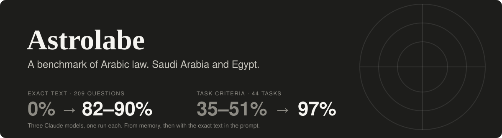

# Astrolabe

<p align="center">
  
</p>

<p align="center">
  
  
  <a href="https://github.com/fr3on/astrolabe/actions/workflows/validate.yml"></a>
  <a href="CONTRIBUTING.md"></a>
</p>

<p align="center">
  
  
  
  
  
</p>

**A benchmark of Arabic law.** First release: Saudi Arabia and Egypt.

Do language models know the law, or do they only sound like they do? Astrolabe checks it in two ways, and runs each one twice: **from memory** (no data) and **with the text** (the source text is given).

| | Exact-text questions | Client-matter tasks |
|---|---|---|
| **Size** | 209 questions | 44 tasks, 208 criteria |
| **The model must** | Give the exact wording of an article, decree or fatwa | Write a short advice note for a client |
| **Scored by** | Code, with no model in the loop | Two model judges, in the [Harvey LAB](https://www.harvey.ai/blog/introducing-harveys-legal-agent-benchmark) format. A criterion counts only when both pass it |

**Browse every task, run and judge verdict at [0x200.com/astrolabe](https://0x200.com/astrolabe).**

## Key findings

- **With the text, models do well.** Every model passes about 97% or more of the task criteria, and 82–97% of the exact-text questions.
- **From memory, they do not remember the text.** On exact wording, no model got more than 1 of 209 right; the Gemini models mostly answer "I don't know".
- **They still reason.** From memory the same models pass 35–73% of the task criteria, because most criteria reward the right conclusion, not the exact article.
- **Both judges are Claude models.** A Gemini judge agreed with them on 206 of 208 criteria in a check, but that is one small check (see [Limits](#limits)).

## Results

Each cell reads **from memory → with the text**. Bold marks the best "with the text" score in each column.

### Claude models

| Model | Exact text right (of 209) | Criteria passed (of 208) | Tasks fully passed (of 44) |
|---|---|---|---|
| Claude Sonnet 4.6 | 0% → 82% | 38% → 97% | 2 → **41** |
| Claude Sonnet 5.5 | 0% → **90%** | 35% → 97% | 1 → 38 |
| Claude Opus 5.5 | 0.5% → 88% | 51% → 97% | 3 → 38 |
| **Average of the three** | 0.2% → 87% | 41% → 97% | 2 → 39 |

### Gemini 4 models

Run as agents with tools. Not in the Claude average.

| Model | Exact text right (of 209) | Criteria passed (of 208) | Tasks fully passed (of 44) |
|---|---|---|---|
| Gemini 4 Neon | 0% → 96% | 70% → 97% | 10 → 40 |
| Gemini 4 Argon | 0% → 91% | 73% → **98%** | 14 → 40 |
| Gemini 4 Hydrogen | 0% → **97%** | pending | pending |

The Gemini and Claude results are not a like-for-like comparison, because the runs were set up differently. See [How the runs differ](#how-the-runs-differ). Per-model notes are in [`docs/RESULTS.md`](docs/RESULTS.md).

### How the runs differ

The groups were set up differently, so read the tables as separate sets of runs, not one controlled comparison.

| Models | How they ran | Tools | Notes |
|---|---|---|---|
| **Claude Sonnet 4.6** | Tasks through an agent harness on AWS Bedrock; exact text through direct API calls | Yes, on tasks | Full run record: transcript, metrics and both judges' verdicts |
| **Claude Sonnet 5.5, Opus 5.5, Gemini 4 Neon, Argon, Hydrogen** | Answered in batches, one run per setting | No web or search | Answers and verdicts only, no transcript |

For Sonnet 5.5 and Opus 5.5 the batches were up to 24 exact-text questions or four tasks per reply, with no tools at all. The Gemini models ran as agents that read the question files and wrote their answers to files; their tool use was not logged, so a search cannot be ruled out. All task notes were graded by the same two judges.

## Scoring

- **Exact text:** right when the answer contains at least 60% of the reference words and at least 80% of the numbers in the reference. Code only; see [`code/`](code/README.md).
- **Tasks:** two judges, Claude Sonnet 4.6 and Claude Opus 4.6, using the unchanged Harvey LAB rubric template. A criterion passes only when both pass it.
- **Sensitivity:** results at 50–80% cutoffs, and the effect of the number rule, are in [`docs/SCORING.md`](docs/SCORING.md). The order of the models does not change between 50% and 70%.

## Limits

- **Judges:** both task judges are Claude models, and Claude models are also scored. As a check, Gemini 4 Neon graded the 208 criteria of Claude Opus 5.5's notes and agreed with the two Claude judges on 206 of 208 (99%). That is one model's notes and one Gemini judge, not a replacement for a second judge across all runs.
- **One run per model:** run-to-run variance is unknown.
- **Lawyer review:** 16 of the 44 tasks were reviewed by a lawyer; the rest are drafts.
- **Different run setups:** see [How the runs differ](#how-the-runs-differ). The Gemini agents had tools and their use was not logged. A check of the from-memory notes found no sign of searching, but cannot rule it out.
- **Sonnet 5.5 and Opus 5.5:** raw exact-text answers were not saved, so a changed scoring rule cannot be applied to them.
- **Scoring rule:** the 60% and number-rule choices are a judgement; see [`docs/SCORING.md`](docs/SCORING.md).
- **Scripts:** run scripts for the exact-text questions and the Dike search check are not in this release yet.

## Paper

Mardi, A. (2026). *Astrolabe: Do language models know Arabic law, or only sound like they do?* Zenodo. [https://doi.org/10.5281/zenodo.24449438](https://doi.org/10.5281/zenodo.24449438)

```bibtex
@misc{mardi2026astrolabe,
  author = {Mardi, Ahmed},
  title  = {Astrolabe: Do language models know Arabic law, or only sound like they do?},
  year   = {2026},
  doi    = {10.5281/zenodo.24449438},
  url    = {https://doi.org/10.5281/zenodo.24449438},
  publisher = {Zenodo}
}
```

## Contributing

See [`CONTRIBUTING.md`](CONTRIBUTING.md). Lawyer review, new tasks and new runs are the most useful.

## Licences

- Code: Apache-2.0 (`LICENSE`).
- Questions, tasks, criteria and run records: CC BY 4.0 (`LICENSE-DATA.md`).
- Source texts (laws, decrees, fatwas) keep the terms of their original publishers and of Dike. See `NOTICE.md`.
